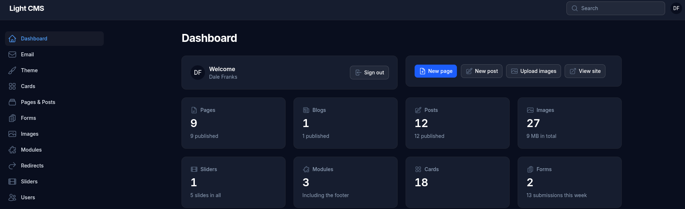

# Getting started

Once the setup screen is done, you're logged in to the admin at `/admin`. A good order for setting up a new site:

1. **Theme**: upload your logo and browser tab icon, and pick your main colors and fonts. Most other colors follow the main ones, so a site looks right with just those set. See [Theme](theme.md).
2. **Email**: check the address email is sent from, and send yourself a test email. See [Email](email.md).
3. **Pages & Posts**: the setup screen made a placeholder home page; replace its content, and add your other pages. Give a page a **Menu order** to put it in the menu. See [Pages & Posts](pages-and-posts.md).
4. **Modules**: edit the footer, which shows at the bottom of every page. See [Cards and Modules](cards-and-modules.md).
5. **Forms**: a Contact form and a Newsletter form are already made. Set who their submissions are emailed to, and place them in a page with `[form:contact]`. See [Forms](forms.md).
6. **Profile**: consider turning on two-step login for your account. See [Users and security](users-and-security.md).

## The Dashboard

The first screen in the admin shows:

- **How much the site holds**: pages, blogs, posts, images (with their total size), sliders, modules, cards and forms, with the number of form submissions this week
- **Quick actions**: New page, New post, Upload images, and View site (which opens the site in a new tab)
- **Recent submissions** from all your forms
- **Recently edited** pages and posts

The version of Light CMS the site is running is shown at the bottom of the admin's menu.
