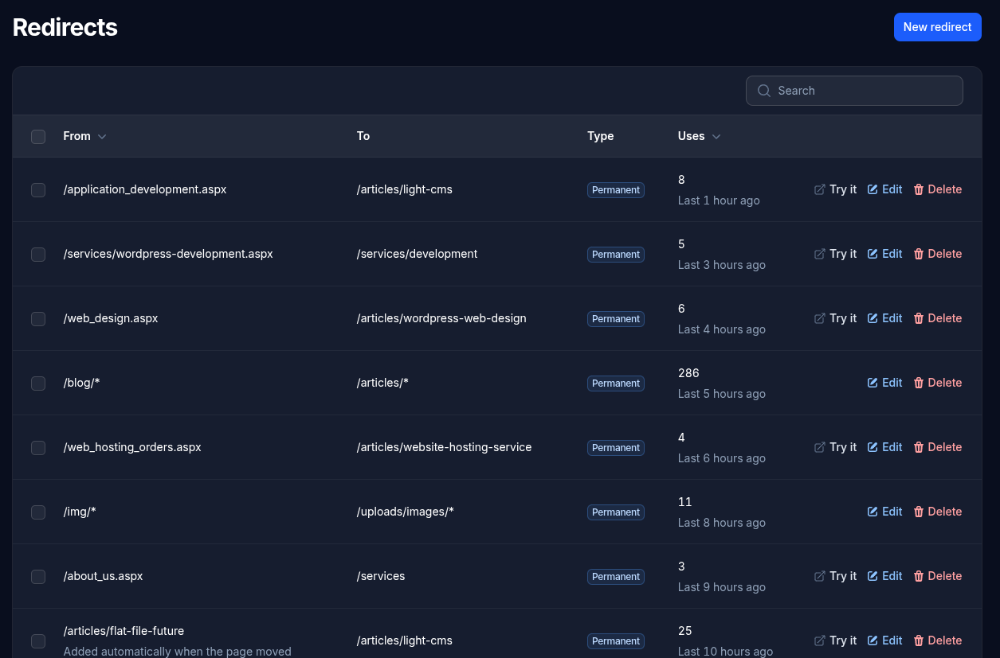

# Redirects

A redirect sends visitors (and search engines) from an address that no longer has a page to a new one. They keep old links and search results working, for example after moving a site from another system.



## Adding a redirect

- **From**: the old address, such as `old-services` or `about_us.aspx`. To send a whole section, end it with `*`: `blog/*` covers every address starting with `blog/`. If the **To** address also ends with `*`, whatever followed is carried over, so `blog/*` to `/articles/*` sends `/blog/my-post` to `/articles/my-post`.
- **To**: where visitors go instead: an address on this site starting with `/`, such as `/services`, or a full web address.
- **Type**: **Permanent (301)** when the old address has moved for good, which tells search engines to move its ranking to the new address. **Temporary (302)** if it may come back.

Capital letters don't matter: `/About_Us.aspx` and `/about_us.aspx` are the same.

## How they work

- A redirect only applies where there's no published page, so it can never hide a live page.
- When a published page's address changes, a redirect from its old address is added automatically (marked "Added automatically"). Redirects that led to the old address are pointed straight at the new one, so visitors never go through a chain.
- **Uses** counts how often each redirect has been followed, and when it was last used, so you can see which old addresses still get visitors.
- **Try it** opens the old address in a new tab to check where it goes.

## Redirecting www to your main address (or another domain)

A site can usually be reached both with and without `www.` (`www.example.com` and `example.com`). Search engines treat those as two different addresses, so it's best to send one to the other. That's a setting for the whole domain, made in the site's `.htaccess` file rather than on the Redirects screen.

In the `.htaccess` file in the site's folder (such as `public_html`), add the two lines below **directly under `RewriteEngine On`**, above the line `RewriteRule ^(.*)$ public/$1 [L]`. Replace `example.com` with your domain:

```apache
<IfModule mod_rewrite.c>
    RewriteEngine On

    # www.example.com goes to example.com, keeping the page
    RewriteCond %{HTTP_HOST} ^www\.example\.com$ [NC]
    RewriteRule ^(.*)$ https://example.com/$1 [R=301,L]

    # /about is answered by public/index.php, /css/site.css by public/css/site.css
    RewriteRule ^(.*)$ public/$1 [L]
</IfModule>
```

Every `www.` address then goes to the same page without it: `www.example.com/contact` to `example.com/contact`.

**If you use cPanel's Redirects tool instead:** cPanel adds its rule at the *end* of `.htaccess`, after the line that sends every visit into the site, so it never runs. Its rule may also only cover `http://` visits. Move the lines it added (a few `RewriteCond` lines and a `RewriteRule`) up to just under `RewriteEngine On`, or replace them with the two lines above.

The same pattern sends an old domain to a new one: use the old domain in the `RewriteCond` line and the new one in the `RewriteRule` line.
